# Diagrams

Every diagram below was drawn from the implementation, not from intent. Where
a path has never executed in production it is marked in the diagram itself,
because a diagram that hides that is worse than no diagram.

Mermaid renders natively on GitHub.

---

## 1. Architecture

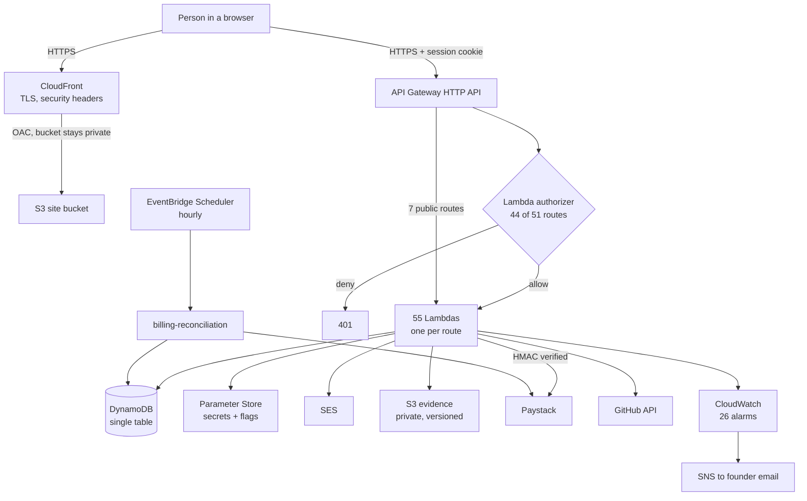

## 2. Candidate journey

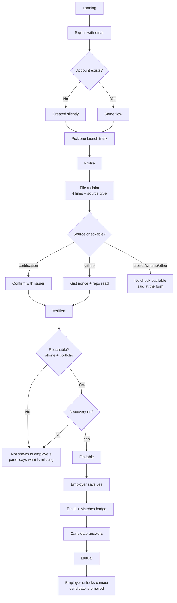

## 3. Employer journey

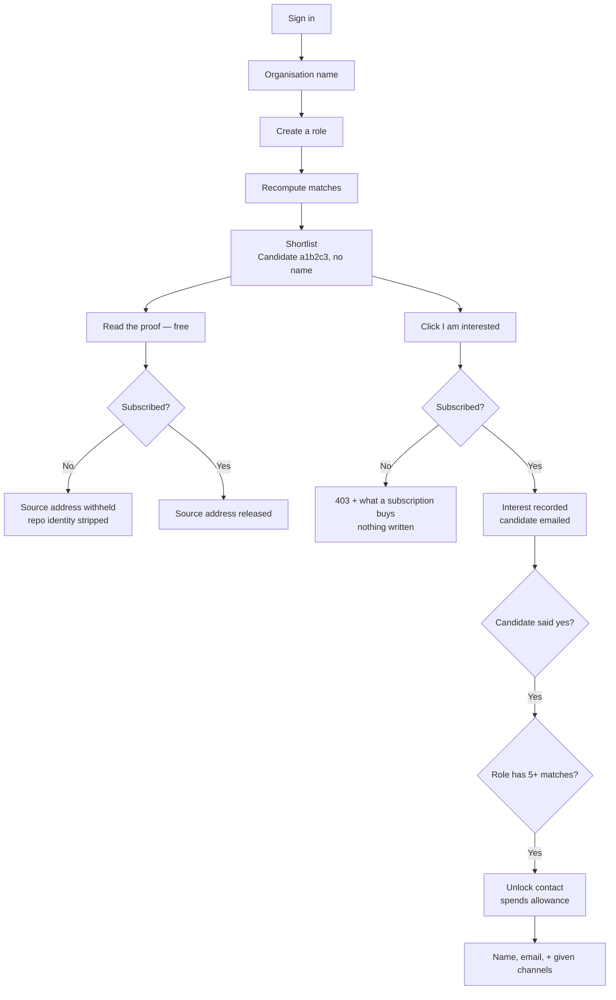

## 4. Authentication

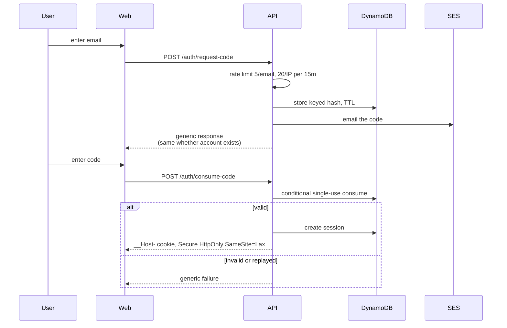

## 5. GitHub verification

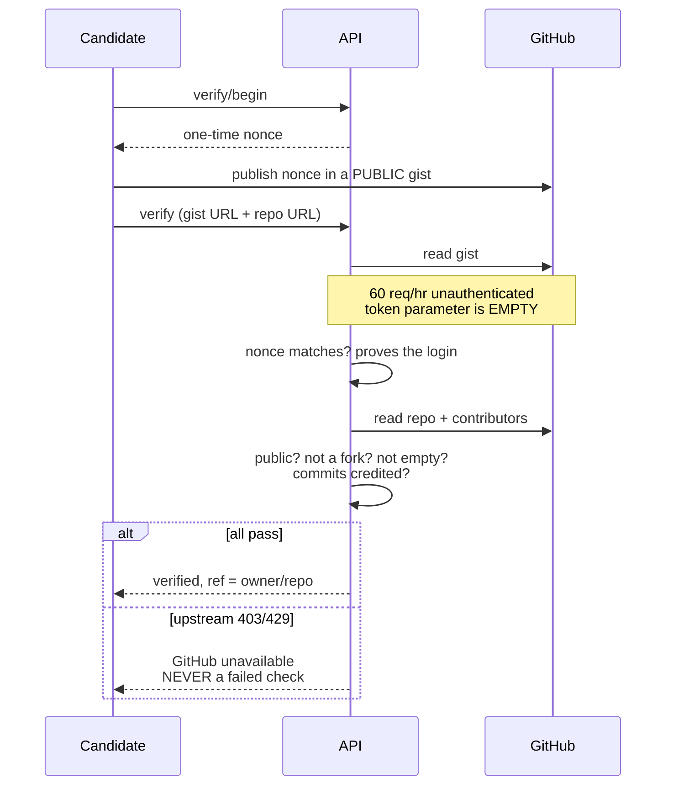

## 6. Payment — and what has never run

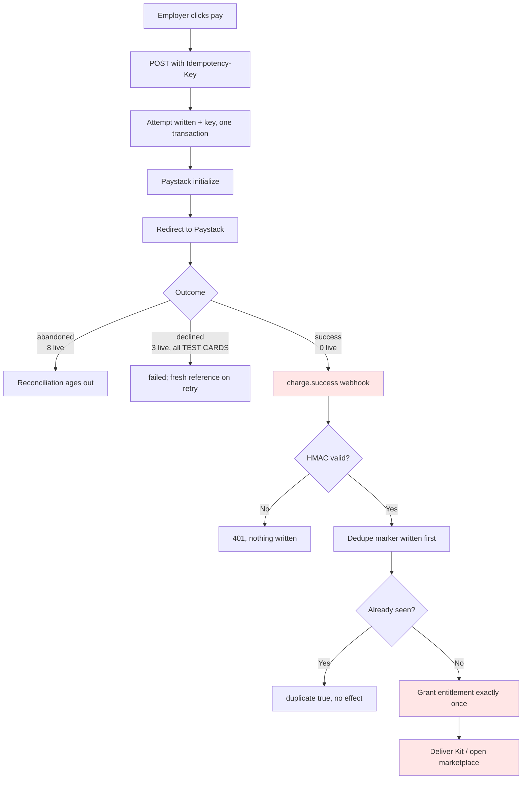

> Red = **never executed in production.** Verified: webhook URL configured,
> signature verification works with the live key, dedupe works. Unverified:
> everything downstream of a real `charge.success`.

## 7. Employer interest → candidate notification

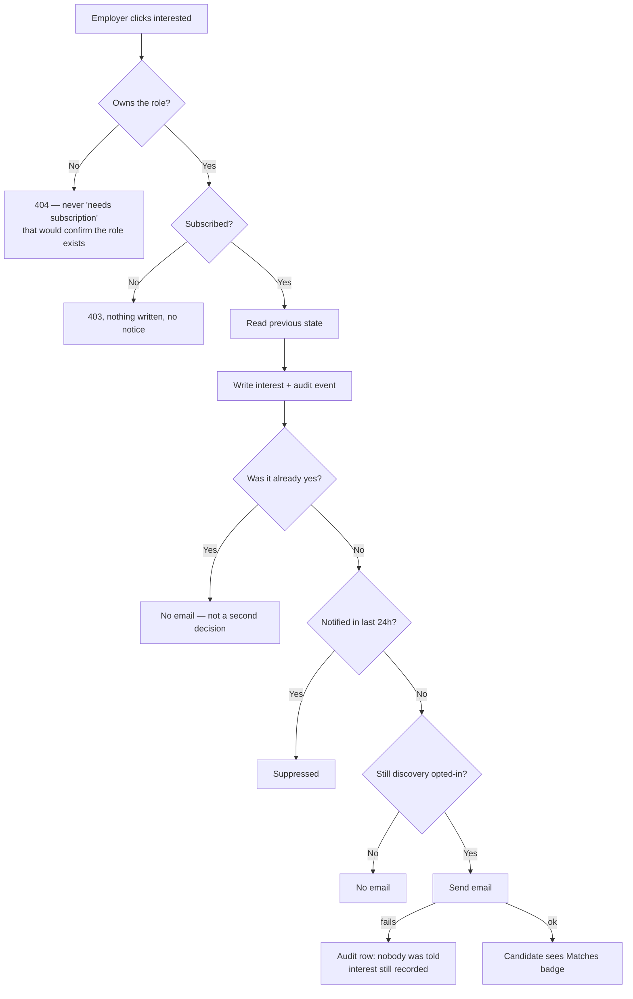

## 8. Contact unlock

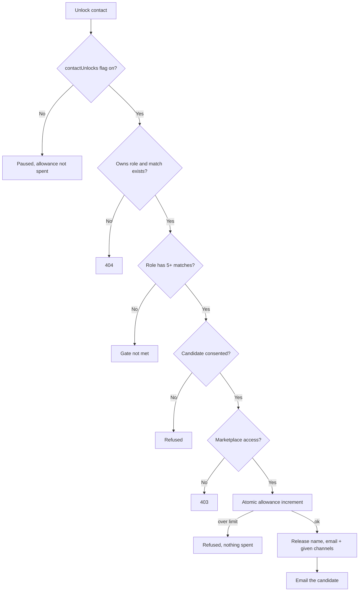

## 9. CI/CD

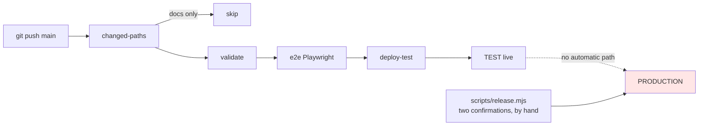

> **There is no production deploy job.** A push to `main` cannot reach
> production.

## 10. Deployment safety

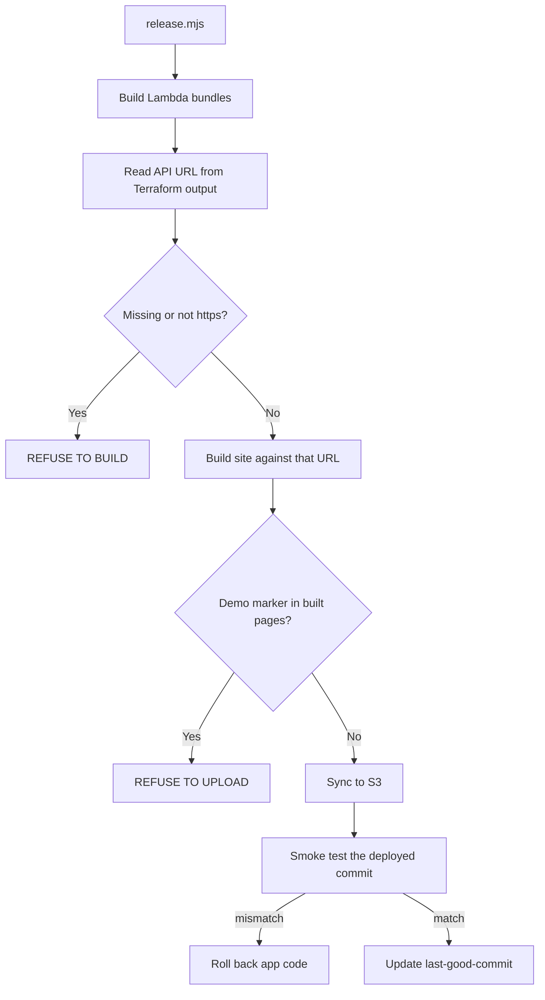

## 11. Rollback

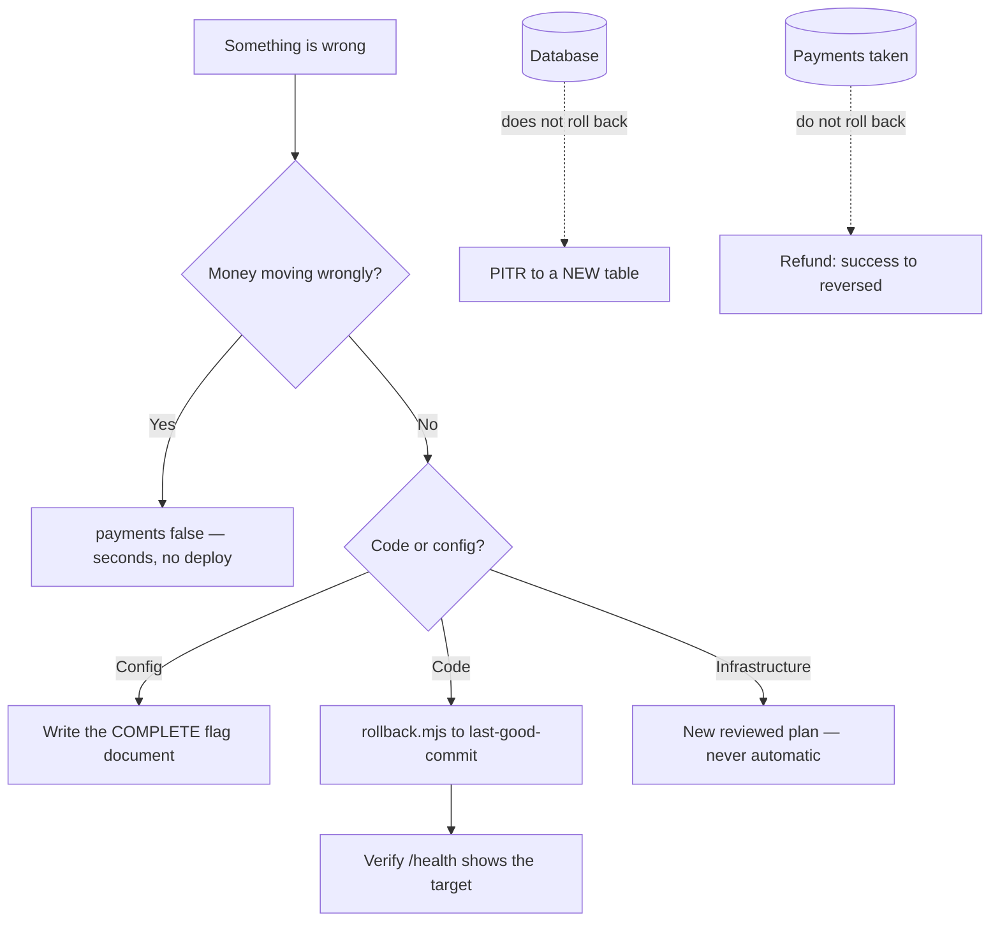

## 12. Data flow and privacy boundaries

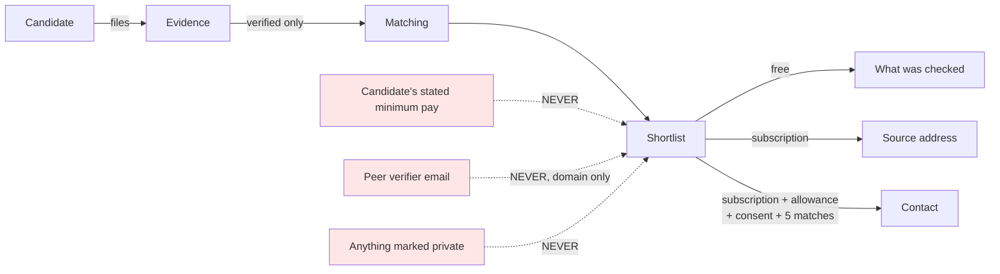
